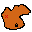

# Far West

A western themed roguelike game.
gameplay loop:
You leave your ranch and cattle behind to pick up your life as bounty hunter again.
You get thrown into a region with a `town` and a `big bounty target`:

In the town there are `shops` were you can by stuff:
- **Grocery store**: consumables for health, stamina, bonus stats etc
- **Stable**: horses
- **Gunshop**: weapons / upgrades / ammo
- **Saloon**: for recruiting extra gang members
- **clothing**: for increasing charisma

## TODO

- [X] animate player
- [X] spawn some cacti
- [X] player revolver
- [X] hitboxes
- [X] collision detection
- [X] shoot mechanics
- [X] bullet hit animation
- [ ] environment destructable?
- [X] enemies
- [ ] interesting enemy behaviour
- [X] minimap
- [X] healthbar
- [X] dodge mechanics / animation
- [X] dodge bar
- [X] ammunition
- [X] reload
- [X] random island world with an ocean border
- [X] level based progression with tougher enemies
- [ ] progress bar after each level when going to the next island
- [ ] island boss (with dynamite sticks as weapon)
- [ ] town buildings (store, sherrif)
- [X] bandit camps (tents, weapon chest, gold chest, ammo chest)
- [ ] bounty post
- [ ] boat dock (with ticket to next island when bounty is killed)
    - [ ] player can choose which island to go next on a map (with difficulty level color coded)
    - [ ] 4 islands on the map (increased difficulty: green -> yellow -> red and one boss island)
- [ ] more sounds (https://sfxr.me/)

## Gameplay improvements
### Quick wins (feel/juice) - DONE
1. Kill the 0-damage roll — actors/player.go:542 uses rand.Intn(damage+1), so with Damage: 3 every shot has a 25% chance to deal 0 (and the hit text even prints -0). Minimum 1 damage would remove the most frustrating moment in combat. This is arguably a bug, not a feature.
2. Enemy hit reaction — enemies currently don't react at all when shot (game.go:583 just subtracts HP). A 3-frame white flash (DrawOptions.ColorScale is already set up per-draw) plus a small knockback along the bullet direction would make every hit land. README already lists "bullet hit animation" as a TODO.
3. Screen shake + hit-stop — camera position is computed at game.go:800; a decaying random offset there, plus a 2–3 frame freeze on a kill, is the classic "weight" upgrade. Cheap to build.
4. Muzzle flash & impact sparks — the gun fires silently into nothing (Draw has no flash); 4–5 short-lived particles at bullet impact using the existing Hit-style lifecycle would help.
5. Show the i-frames — the dodge now grants invulnerability but nothing communicates it; blinking the player sprite during IsDodging() teaches players to trust it.
### Combat depth - TODO
6. Make Fists real — the Fists weapon exists (key 0) but Shoot() bails at player.go:175, so it's a dead button. A short-range punch with high damage vs. closing distance through bullets = actual risk/reward.
7. Cleverer AI — ActionType already declares Shoot and FindCover (actors/action.go:13) but neither is ever used. Enemies could retreat behind cacti, which already block bullets (game.go:627) — instant tactical depth from existing systems.
8. Enemy archetypes — only one enemy type exists. A charger (melee, fast, low HP), shotgunner (spread, short range), and heavy (slow, tanky) would all slot into ThinkAndAct/Action. Melee enemies especially: right now enemies can't hurt you up close, so dodge i-frames only matter against bullets.
9. Melee pressure for you too — enemies only body-block; a lunge attack would make positioning and the dodge meaningful under pressure.
### Bigger swings - TODO
10. Ammo economy — reload exists but ammo is infinite; limited ammo + drops makes each shot count (gunshop/ammo is already in the README roadmap).
11. Health drops or slow regen — 20 HP with zero recovery mid-level means one rough level ends the run; the planned grocery store could cover this.

## Survival run

The game is played in levels. Every level drops you on a randomly shaped
island, the ocean around it is the border of the world. You have to wipe out
every bandit to advance to the next level.

Bandits live in one to three bandit camps per island. Each camp has tents,
chests and a group of enemies that spawn and wander around it instead of
roaming the whole island. The minimap shows the location of the camps, not the
individual bandits.

The first level starts with 6 normal enemies. Every following level the enemies
get tougher — more health, harder hitting bullets and a faster fire rate — and
there are more of them, up to a cap. When a level is cleared an overview shows
your score and time, press `N` or the `A` button to continue to the next level,
where you respawn on a fresh island with your full health back.

Killing an enemy gives you points. Running out of health ends the run on the
level you are on and pressing `Space` starts a fresh run from level 1.

## Controls

| Action | Keyboard | Gamepad |
| --- | --- | --- |
| Move | `Z`/`W`, `Q`/`A`, `S`, `D` | Left stick |
| Aim | Mouse (free angle) | Right stick (free angle) |
| Shoot | `Space` or left mouse | Right bumper (`FTR`) |
| Reload | `R` | Right right face button (`RR`) |
| Dodge | `Left Shift` | Left bumper (`FTL`) |
| Switch weapon | `0`-`4`, `Tab` | D-pad right (`LR`) |
| Pick up gun | `E` | Right top face button (`RT`) |
| Compare gun | `Q` (hold) | Right left face button (`RL`) |
| Pause | `P` | Right trigger (`FBR`) |
| Continue after level | `N` | Right bottom face button (`RB`) |
| Start / restart | `Space` | Right trigger (`FBR`) |
